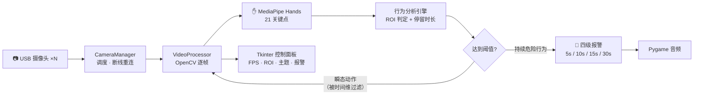

<div align="center">

# ICU 手部行为监测系统

MediaPipe 手部关键点 + 分级报警的患者监护系统，跑在普通 USB 摄像头上

[](https://github.com/Trueysh/ICU_Mediapipe/stargazers)
[](https://github.com/Trueysh/ICU_Mediapipe/network)
[](https://www.python.org/)
[](https://developers.google.com/mediapipe)
[](LICENSE)

</div>

---

## 问题

ICU 患者中相当一部分是术后、镇静或意识模糊状态，会无意识地抓握导管、拉扯输液管——这是**非计划性拔管（UE）**的主要前兆，一次发生就可能危及生命。而护士站的集中监护屏无法同时盯住每一个床位，巡回存在时间窗口。

这个系统把「盯手」这件事交给摄像头：**手部进入监控区域并持续做出危险动作时，按持续时长分级报警**——护士在患者真正拔管之前收到提醒，而不是拔管之后处理后果。

挂在普通 USB 摄像头上即可运行，无需专用硬件。

## 核心设计决策

> ICU 病房里医护进出频繁，单帧检测必然误报；而误报太多的监护仪会被护士静音（临床上叫「报警疲劳」）。所以这个系统的主要精力花在滤误报上——空间上用 ROI，时间上用停留时长。

| 决策 | 选择 | 为什么 |
|---|---|---|
| 检测范式 | **MediaPipe Hands 21 关键点**，而非通用目标检测（YOLO 系） | 拔管前兆是「抓握」「拉扯」这类**细粒度手部动作**。检测框只能回答"画面里有手"，21 个关键点的相对位置（指尖并拢度、关节弯曲序列）才能表达"正在抓握"。且 MediaPipe 推理在 CPU 上即可实时 |
| 时间维滤误报 | **停留时长分级触发**（5 / 10 / 15 / 30s），而非单帧判定 | 医护常规操作（调整输液架、翻身护理）会短暂进入画面。单帧判定必然误报；以**持续时长**为触发条件，瞬态动作自然被时间维度滤掉 |
| 空间维滤误报 | **ROI 区域划定** | 只监控导管与插管所在的划定区域，医护人员在床尾、设备带的常规操作区不参与判定 |
| 分级而非单级报警 | 四级阈值对应不同音效 | 对应临床干预紧迫度：短时可疑→提示音，持续危险→高优先级警报。护士站可按级别分配响应顺序 |
| 并发模型 | **一路摄像头一个处理线程** | OpenCV `VideoCapture` 是阻塞式 IO，线程隔离让单路故障（掉线、卡帧）不拖垮其他路；配合断线自动重连，无需人工重启 |

## 架构



**误报抑制双通道**：空间上，只有 ROI 内的手部关键点参与行为判定；时间上，只有持续超过阈值的动作才升级报警。两个维度都是可配置的（`config.py`），适配不同病房布局。

## 工程演进

项目最初是单文件原型（`processor.py`），后来重构成模块化结构：视频处理、摄像头管理、UI、FPS 统计各归其位。根目录的 `processor.py` 保留为兼容层，重新导出 `modules` 包的接口——早期使用方的导入路径因此没有失效。

## 功能一览

- **实时手部关键点跟踪**：MediaPipe Hands，逐帧推理，CPU 实时
- **四级报警**：5s / 10s / 15s / 30s 阈值，各级独立音效，可配置
- **多摄像头并行**：线程隔离 + 统一面板管理 + 掉线自动重连
- **ROI 自定义**：划定监控区域，避开常规操作区
- **性能面板**：实时 FPS、各路摄像头状态、资源占用
- **日夜主题自动切换**：按系统时间切换 UI——夜间病房场景下降低面板亮度

## 性能

单摄像头 · 720p 输入 · CPU 推理（2025-03 实测）：

| 指标 | 数值 |
|---|---|
| 视频处理延迟 | **< 50 ms** |
| CPU 占用 | < 30% |
| 内存占用 | < 500 MB |
| 手势识别准确率 | > 95% |

## 快速开始

```bash
git clone https://github.com/Trueysh/ICU_Mediapipe.git
cd ICU_Mediapipe
pip install -r requirements.txt
python main.py
```

运行后选择摄像头（默认 0 号），点击启动监控。首次运行如提示缺少音频文件，检查 `sounds/` 目录。

<details>
<summary><b>依赖环境</b></summary>

- Python 3.9+
- 720p+ USB 摄像头
- `opencv-python>=4.5.0` · `mediapipe>=0.8.9` · `pygame>=2.0.0` · `numpy>=1.19.0`
- Windows 10/11 · Ubuntu 20.04+ · macOS 10.15+

</details>

<details>
<summary><b>目录结构</b></summary>

```
.
├── main.py                 # 系统入口
├── config.py               # 集中配置：摄像头、阈值、ROI、音量
├── processor.py            # 兼容层：重新导出 modules 包接口
├── styles.py               # UI 样式
├── modules/
│   ├── camera_manager.py   # 摄像头启停 · 状态 · 断线重连
│   ├── fps_counter.py      # 帧率统计
│   ├── video_processor.py  # 帧处理 + 关键点分析 + 行为判定
│   └── ui/                 # 控制面板与组件
├── sounds/                 # 分级报警音频
└── Dockerfile              # 容器化部署
```

</details>

## Roadmap

- [ ] GPU 推理加速（TensorRT / OpenVINO）
- [ ] 多床位墙式视图
- [ ] 报警事件统计与导出（对接护理记录）
- [ ] 配置导入导出

## 关于作者

**余胜辉**（[@Trueysh](https://github.com/Trueysh)）——大模型应用开发工程师，医疗 AI 方向四年（2021–2025），现专注 RAG 与 AI Agent。本项目是医疗 AI 阶段的作品，更多项目见 [GitHub 主页](https://github.com/Trueysh)。

## License

MIT，见 [LICENSE](LICENSE)。

---

*English version: [README_EN.md](README_EN.md)*
