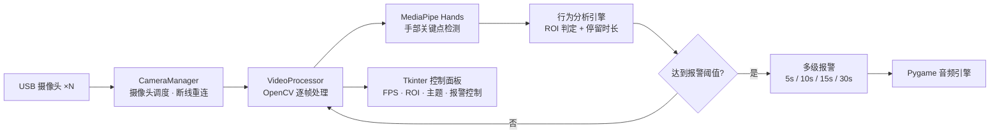

# ICU 手部行为监测系统

[](https://github.com/Trueysh/ICU_Mediapipe/stargazers)
[](https://www.python.org/)
[](LICENSE)

基于计算机视觉的 ICU 患者安全监护系统：用 MediaPipe 手部关键点检测识别患者的危险手部行为，配合多级报警机制提醒医护介入。

当前版本 **v2.8**（2025-03）。

## 为什么做这个

ICU 患者（尤其是术后、意识不清或老年患者）可能出现无意识抓握导管、抬手拔扯输液管等行为，发现不及时会导致非计划性拔管。护士站人工盯屏不可能覆盖每一个床位。

这个系统挂在普通 USB 摄像头上跑：手进入监控区域并持续做出危险动作时，按停留时长分级报警，让护士先看这里，而不是等巡回时才发现。

## 功能

- **实时手部关键点检测**：MediaPipe Hands，逐帧跟踪
- **多级报警**：危险行为持续 5s / 10s / 15s / 30s 分别触发不同级别，各级别音效不同；阈值可在配置文件里改
- **多摄像头并行**：一路摄像头一个处理线程，统一在一个面板里管理
- **ROI 自定义**：只监控画面里的划定区域，避开医护人员常规操作区
- **断线自动重连**：摄像头掉线后自动尝试恢复，无需重启系统
- **性能面板**：实时 FPS、各摄像头状态、资源占用
- **自动主题切换**：按系统时间切换日间 / 夜间界面

## 架构



数据流：摄像头帧经 OpenCV 预处理后送入 MediaPipe 推理，关键点序列交给行为分析引擎做 ROI 判定与停留时长统计；触发阈值后由音频引擎按级别播放报警音，同时面板上高亮对应摄像头。

## 性能指标

以下为单摄像头、720p 输入下的实测值（发布日期 2025-03）：

| 指标 | 数值 |
|---|---|
| 视频处理延迟 | < 50 ms |
| CPU 占用 | < 30% |
| 内存占用 | < 500 MB |
| 手势识别准确率 | > 95% |

## 快速开始

```bash
git clone https://github.com/Trueysh/ICU_Mediapipe.git
cd ICU_Mediapipe
pip install -r requirements.txt
python main.py
```

运行后选择摄像头（默认 0 号），点击启动监控。首次运行如提示缺少音频文件，检查 `sounds/` 目录。

## 配置

系统参数集中在 `config.py`：

| 参数 | 说明 |
|---|---|
| 摄像头索引与分辨率 | 支持多路配置 |
| 报警阈值 | 多级触发时长（秒） |
| ROI 区域 | 监控范围坐标 |
| 报警音量 | 各级别音量 |

## 目录结构

```
.
├── main.py                 # 系统入口
├── config.py               # 集中配置：摄像头、阈值、ROI、音量
├── processor.py            # 摄像头处理器核心逻辑（CameraManager）
├── styles.py               # UI 样式定义
├── modules/
│   ├── camera_manager.py   # 摄像头启停与状态管理
│   ├── fps_counter.py      # 帧率统计
│   ├── video_processor.py  # 帧处理 + 手势识别 + 行为分析
│   └── ui/
│       ├── components.py   # UI 组件：时间显示、主题选择、摄像头选择
│       └── control_panel.py# 主控制面板
├── sounds/                 # 报警音频
└── logs/                   # 运行日志
```

## 截图

> 仓库暂未内置截图。以下位置留待补充（把图片放进 `docs/` 后取消注释即可显示）：
>
> `docs/screenshot-main.png` 主界面与控制面板 ｜ `docs/screenshot-roi.png` ROI 划定效果 ｜ `docs/screenshot-alarm.png` 报警触发状态

## 环境要求

- Python 3.9+
- 720p 或更高分辨率 USB 摄像头
- 依赖：`opencv-python>=4.5.0` `mediapipe>=0.8.9` `pygame>=2.0.0` `numpy>=1.19.0`
- Windows 10/11 · Ubuntu 20.04+ · macOS 10.15+

## Roadmap

- GPU 推理加速（TensorRT / OpenVINO）
- 多床位移墙视图
- 报警事件统计与导出
- 配置文件导入导出

## 关于作者

**余胜辉**（[@Trueysh](https://github.com/Trueysh)）——大模型应用开发工程师，现专注 RAG 与 AI Agent。本项目完成于医疗 AI 阶段（2021–2025），更多项目见 [GitHub 主页](https://github.com/Trueysh)。

## License

MIT，见 [LICENSE](LICENSE)。

---

*最后更新：2025-03*
