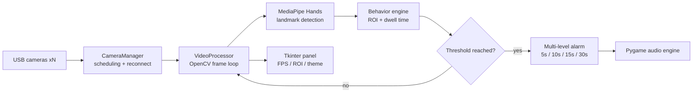

# ICU Hand Behavior Monitoring System

[](https://github.com/Trueysh/ICU_Mediapipe/stargazers)
[](https://www.python.org/)
[](LICENSE)

A computer-vision safety monitoring system for ICU patients. It uses MediaPipe hand landmark detection to recognize risky hand behaviors (e.g. pulling at lines and tubes) and escalates alarms by dwell time so nurses can react before an unplanned extubation happens.

Current version: **v2.8** (2025-03).

## Features

- Real-time hand landmark tracking (MediaPipe Hands)
- Multi-level alarms at 5s / 10s / 15s / 30s dwell thresholds, configurable
- Multi-camera parallel processing in a single control panel
- Customizable ROI to exclude staff working zones
- Auto-reconnect on camera drop
- Live FPS and resource panel
- Day / night theme switching by system time

## Architecture



## Performance (single camera, 720p)

| Metric | Value |
|---|---|
| Frame latency | < 50 ms |
| CPU usage | < 30% |
| Memory | < 500 MB |
| Gesture accuracy | > 95% |

## Quick start

```bash
git clone https://github.com/Trueysh/ICU_Mediapipe.git
cd ICU_Mediapipe
pip install -r requirements.txt
python main.py
```

## Requirements

Python 3.9+, 720p+ USB camera. Dependencies: `opencv-python>=4.5.0` `mediapipe>=0.8.9` `pygame>=2.0.0` `numpy>=1.19.0`.
Windows 10/11 · Ubuntu 20.04+ · macOS 10.15+.

## Author

**Yu Shenghui** ([@Trueysh](https://github.com/Trueysh)) — LLM application engineer, currently focused on RAG and AI agents. This project was built during the healthcare-AI phase (2021–2025). See [GitHub profile](https://github.com/Trueysh) for more.

## License

MIT — see [LICENSE](LICENSE).
