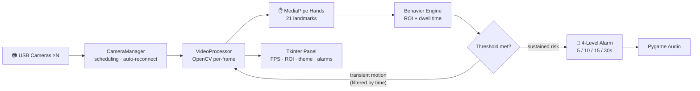

<div align="center">

# ICU Hand Behavior Monitoring System

A patient-monitoring system built on MediaPipe hand landmarks and tiered alarms, running on ordinary USB cameras

[](https://github.com/Trueysh/ICU_Mediapipe/stargazers)
[](https://github.com/Trueysh/ICU_Mediapipe/network)
[](https://www.python.org/)
[](https://developers.google.com/mediapipe)
[](LICENSE)

</div>

---

## The Problem

Patients in ICUs — post-surgery, sedated, or confused — may unconsciously grab and pull at catheters and infusion lines. This is the leading precursor of **unplanned extubation (UE)**, which can be life-threatening. Central monitoring stations cannot watch every bed simultaneously, and nursing rounds leave time windows uncovered.

This system assigns the "watch the hands" job to a camera: **when a hand enters the monitored region and keeps performing risky movements, it escalates alarms by dwell time** — nurses get alerted before the patient actually pulls the tube, not after.

Runs on ordinary USB cameras. No dedicated hardware.

## Key Design Decisions

> In a real ICU ward, staff walk in and out constantly, so single-frame detection inevitably false-alarms — and monitors that cry wolf get muted by nurses (a documented clinical problem called *alarm fatigue*). Most of the design effort here therefore goes into filtering false positives: spatially via ROI, temporally via dwell time.

| Decision | Choice | Why |
|---|---|---|
| Detection paradigm | **MediaPipe Hands (21 landmarks)**, not generic object detectors | Pre-extubation behaviors are fine-grained actions like *grasping* and *tugging*. A bounding box says "there is a hand"; only landmark geometry (fingertip closure, joint flexion sequences) can express "currently grasping". And MediaPipe runs real-time on CPU |
| Temporal filtering | **Dwell-time thresholds** (5 / 10 / 15 / 30s), not single-frame judgment | Routine care (adjusting IV stands, turning patients) briefly enters the frame. Single-frame detection must false-alarm; requiring sustained duration filters transients naturally |
| Spatial filtering | **Configurable ROI** | Only the region around catheters and lines is judged; staff working zones are excluded |
| Escalated alarms | Four levels with distinct sounds | Maps to clinical urgency: brief suspicion → soft tone; sustained danger → high-priority alert. Nurses can triage response order |
| Concurrency | **One thread per camera** | OpenCV `VideoCapture` is blocking IO; thread isolation keeps one failing stream (drop, stall) from dragging down the rest, with auto-reconnect |

## Architecture



## Engineering Evolution

The project started as a single-file prototype (`processor.py`) and was later refactored into a modular package — video processing, camera management, UI, and FPS counting each in their own module. The root `processor.py` remains as a compatibility layer re-exporting the package's interface, so existing imports kept working.

## Features

- Real-time hand landmark tracking (MediaPipe Hands), CPU real-time
- 4-level alarms at 5 / 10 / 15 / 30s dwell thresholds, all configurable
- Multi-camera parallel processing with auto-reconnect
- Customizable ROI excluding staff working zones
- Live FPS / camera status / resource panel
- Automatic day/night theme switching (dimmer UI for night wards)

## Performance

Single camera · 720p · CPU inference (measured 2025-03):

| Metric | Value |
|---|---|
| Processing latency | **< 50 ms** |
| CPU usage | < 30% |
| Memory | < 500 MB |
| Gesture recognition accuracy | > 95% |

## Quick Start

```bash
git clone https://github.com/Trueysh/ICU_Mediapipe.git
cd ICU_Mediapipe
pip install -r requirements.txt
python main.py
```

Requires Python 3.9+, a 720p+ USB camera, and `opencv-python` / `mediapipe` / `pygame` / `numpy`. Works on Windows 10/11, Ubuntu 20.04+, macOS 10.15+.

## Roadmap

- [ ] GPU inference acceleration (TensorRT / OpenVINO)
- [ ] Multi-bed wall view
- [ ] Alarm event statistics & export (nursing-record integration)
- [ ] Config import/export

## Author

**Yu Shenghui** ([@Trueysh](https://github.com/Trueysh)) — LLM application engineer, 4 years in medical AI (2021–2025), now focused on RAG and AI Agents. More projects on my [GitHub profile](https://github.com/Trueysh).

## License

MIT — see [LICENSE](LICENSE).

---

*中文版：[README.md](README.md)*
